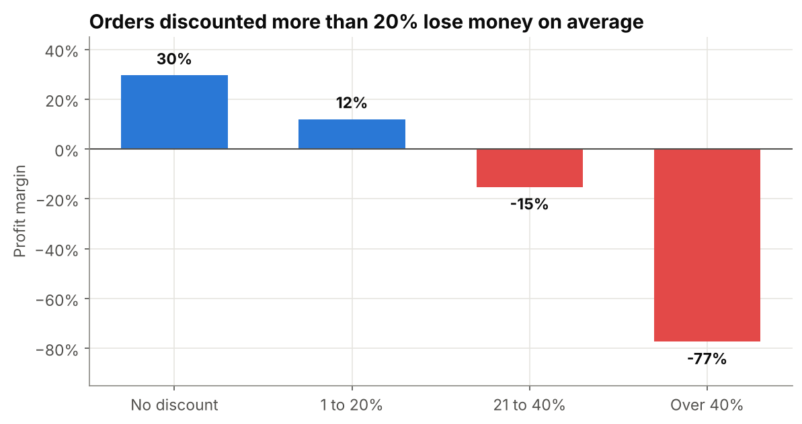
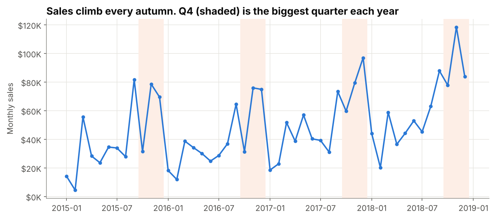
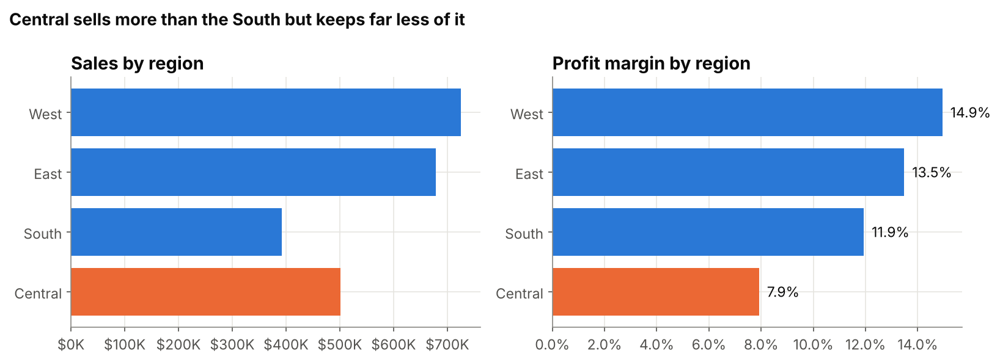
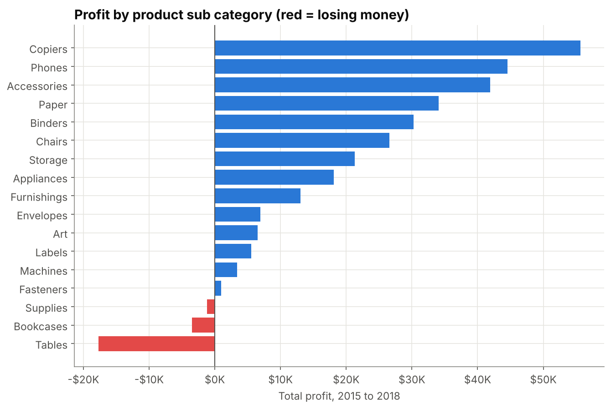
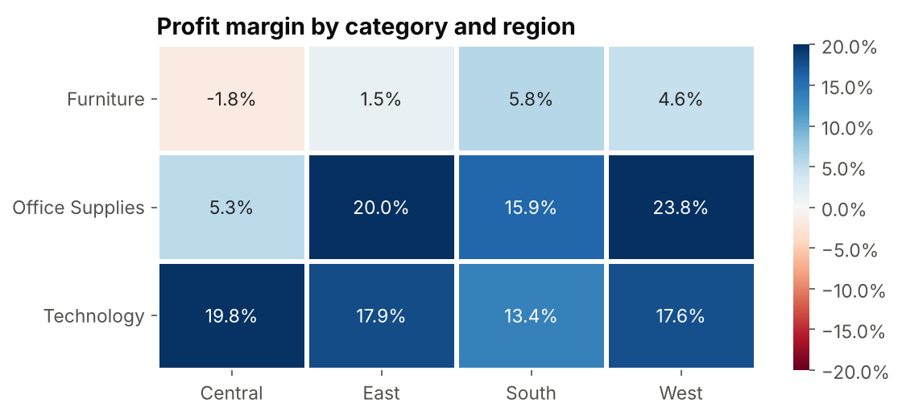

# Superstore Sales Analysis

I analyzed four years of sales from a US office supplies retailer to answer one question. **Where does the company make money, where does it lose money, and what should it change?**

The short answer. Heavy discounts wipe out almost half of the profit the company earns. Capping discounts at 20% is the single biggest fix.



## Key results

| Metric | Value |
|---|---|
| Total sales (2015 to 2018) | $2.30M |
| Total profit | $286K (12.5% margin) |
| Sales growth, 2015 to 2018 | +51% |
| Share of sales in Q4 | 38% |
| Profit lost on orders discounted over 20% | $135K |

## Dataset

* **Source.** Sample Superstore, the retail dataset Tableau publishes and one of the most used sales datasets on [Kaggle](https://www.kaggle.com/datasets/vivek468/superstore-dataset-final). This copy (2015 to 2018 version) comes from [leonism/sample-superstore](https://github.com/leonism/sample-superstore).
* **Size.** 10,800 raw rows, 9,994 order lines after cleaning
* **Key columns.** Order date, region, state, category, sub category, sales, quantity, discount, profit

## Tools

Python with pandas, matplotlib and seaborn, in a Jupyter notebook.

## What I did

1. **Cleaned the data.** Removed 806 blank rows, checked for duplicates, standardized column names, converted dates, and kept 11 missing postal codes as missing instead of guessing them.
2. **Explored trends over time.** Yearly growth, monthly sales and seasonal patterns.
3. **Compared regions and products.** Sales, profit and profit margin for each region and product group.
4. **Tested the effect of discounts.** Grouped orders by discount level and compared profit margins.
5. **Turned findings into recommendations.**

## Findings

### 1. Sales peak in Q4 every year
Q4 brings in 38% of yearly sales, more than Q1 and Q2 combined.



### 2. Central sells a lot but keeps little of it
Central has the lowest profit margin (7.9%) and the deepest average discount (24%, more than double the West).



### 3. Three product groups lose money
Tables, Bookcases and Supplies lose money. Tables alone lost about $18K. Copiers, Phones and Accessories earn the most.



### 4. Furniture in Central loses money
Technology earns a healthy margin in every region. Furniture barely breaks even anywhere.



### 5. Discounts over 20% lose money
Orders with no discount earn a 30% margin. Orders discounted over 40% lose 77 cents on every dollar. The five states that lose the most money all give average discounts between 28% and 39%.

## Recommendations

1. **Cap standard discounts at 20%** and require approval above that.
2. **Fix or reprice Tables and Bookcases.** Stop discounting Tables.
3. **Start in Central and the five loss making states** (Texas, Ohio, Pennsylvania, Illinois, North Carolina).
4. **Plan stock and marketing for Q4.** Push high margin items like Copiers, Phones and Paper.

**Limits.** The data has no cost or customer traffic details, so these results show links, not proven causes. A discount test in one region would confirm the effect.

## Repository structure

```
sales-analysis/
├── sales_analysis.ipynb      full analysis with code and outputs
├── data/
│   ├── superstore_raw.csv    original data
│   └── superstore_clean.csv  cleaned data
├── images/                   charts used in this README
└── requirements.txt
```

## Run it yourself

```bash
pip install -r requirements.txt
jupyter notebook sales_analysis.ipynb
```
